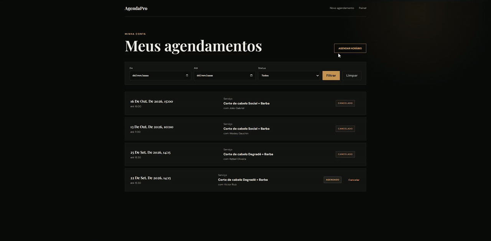

# AgendaPro API

[Português](README.md) | **English**

[](https://github.com/msampaio-dev/AgendaPro/actions/workflows/backend-ci.yml)
[](https://openjdk.org/projects/jdk/21/)
[](https://spring.io/projects/spring-boot)
[](LICENSE)


Booking API for barbershops, written in Java 21 and Spring Boot. Each barbershop has its own staff, catalog and business hours, and the customer chooses where and with whom to book. Two bookings for the same time slot are never accepted together, even when they arrive at the same instant, because the database itself rejects the second one.

> Try it at [agenda-pro-web-agendapro2.vercel.app](https://agenda-pro-web-agendapro2.vercel.app/). The frontend code is in [msampaio-dev/AgendaPro-Web](https://github.com/msampaio-dev/AgendaPro-Web). The UI and the code identifiers are in Portuguese.

## Highlights

- No slot is ever booked twice, even when two people click at the same instant. The application checks first, and PostgreSQL rejects the overlap if both requests get through.
- Free slots take into account the professional's working hours, the shop's opening hours, lunch breaks, blocked periods, extra hours and existing bookings.
- Each barbershop has its own professionals, services, prices, staff and history.
- Local times use `LocalDate` and `LocalTime`, and bookings are stored as `Instant`, with each professional's `ZoneId`.
- Customer, professional, shop owner and administrator have different permissions.
- Hibernate only validates the schema. Every database change goes through Flyway.
- Integration tests run against a throwaway PostgreSQL with Testcontainers and never touch the local database.
- The customer can describe the booking in free text. Claude interprets the request, and the API checks the answer and computes the slots with the usual rules.

## The product

The customer picks the barbershop, the professional and the service (with beard trim as an add-on) and only sees free slots. Professionals manage their own schedule, working hours, lunch break and blocked periods. The shop owner manages the shop, the staff and the catalog with their own prices, and the administrator oversees the whole platform.

The full feature list and the screens for each role are in the [frontend README](https://github.com/msampaio-dev/AgendaPro-Web#experiência-por-perfil) (in Portuguese).

## The most important rule

A professional can never have two bookings that occupy the same interval.

```text
Existing booking:   14:00 ───────── 14:30
New attempt:               14:15 ───────── 14:45  → rejected
Adjacent interval:                       14:30 ─── 15:00  → allowed
```

The protection has two layers:

1. the service checks for an overlap beforehand;
2. PostgreSQL enforces an exclusion constraint on `tstzrange`.

A concurrency test against a real PostgreSQL fires two requests at practically the same time and confirms that only one of them gets the slot.

## AI booking suggestion



The customer can ask for a booking in writing instead of going step by step. In the GIF, they type "Barba e corte com Wesley sexta-feira de tarde" (beard and haircut with Wesley, Friday afternoon) and the screen fills in the barbershop, professional, service and date, with the free slots for that afternoon. They pick 16:00 and confirm.

The API sends the text to Claude Haiku 5.5 together with the barbershops' catalog and a calendar of the next 14 days. The model returns JSON with catalog ids, a date and a time of day. The call uses structured output, so the JSON always follows the schema defined in code. The backend checks every id, rejects dates in the past or too far ahead and computes free slots with the same rules as the manual screen.

The AI never books anything. A booking only happens when the customer confirms, through the same `POST /agendamentos` and the same database constraint. If the suggestion is wrong, the Adjust button opens the form.

The customer has the final say because some model mistakes look correct to the code. It may pick the wrong João when two professionals share a name, read "Friday" as next week's Friday, or swap a fade for a classic cut. All of these suggestions pass validation, and only the person who wrote the request can tell they are wrong.

| What can go wrong | How the system responds |
|---|---|
| The model returns an id that doesn't exist or mixes barbershops | 422, and the screen falls back to manual selection |
| The date is invalid, in the past or more than 60 days ahead | 422 |
| The model refuses the request or the response is truncated | 422 |
| The Claude API rejects the call because of overload or an internal error | One retry; if it fails again, 503 and the usage goes back to the quota, because rejected calls aren't billed |
| The Claude API takes longer than 8 s | 503 with no retry, and the usage still counts, because the request may have been processed and billed |
| The requested day has no free slot in that period | The suggestion brings the next date with a free slot and says it changed |
| Someone tries to burn through the demo quota | Limit of 5 suggestions per user and 30 in total per day, counted in the database, with a lock that also covers bursts of new accounts |
| The text tries to give the model instructions | The text is sent delimited as data, and only catalog ids pass validation |

The API key lives only in the `ANTHROPIC_API_KEY` environment variable. Without it the application works normally and the suggestion endpoint returns 503. Tests never call the real API: a local HTTP server stands in for Claude and returns valid responses, broken JSON, refusals, truncated responses and 500 errors.

### What went wrong when testing against the real model

The automated tests simulate the API, so they only prove that the code handles the responses someone thought of. Before merging, I ran 12 real requests against Claude Haiku 5.5. The integration worked on the first try, with responses between 1.4 and 4.7 seconds, but only 8 of the 12 requests produced the right result.

The main error was a design flaw. Each barbershop has its own ids for the same services, and the prompt told the model to leave the barbershop empty when the customer didn't name one. Without a barbershop, the model had nowhere to take the service id from and left it empty, so clear requests like "fade haircut tomorrow morning" were rejected. The note shown to the user also made up a professional "with a similar name" and said "booked with Henrique" when nothing had been booked. I changed the prompt to pick the first barbershop that offers the service, and correct results went up to 10 of 12.

Two errors remained. A professional who doesn't exist ("haircut with Ricardo") made the model give up on the whole request. And "next Monday", asked on a Monday, became today's date: a valid suggestion that looks right and that no backend validation can catch. After one more adjustment, all 12 requests passed. I also wrote 4 new requests just for this round, so I wouldn't tune the prompt to the cases I already knew, and they passed. One of them showed that my rule for "next Friday" was wrong: in everyday use it means the coming Friday, and the model did that even against the rule.

The three rounds cost about 4 US cents. The "next Monday" case is why the final decision stays with the customer: the screen shows the date it understood before any booking, and only the person who asked knows whether it's right.

## Architecture

AgendaPro is a modular monolith, organized by feature.

```text
com.agendapro
├── auth
├── usuario
├── profissional
├── barbearia
├── profissionalservico
├── servico
├── disponibilidade
├── agendamento
├── sugestao
├── security
└── shared
```

```text
HTTP/JSON
   │
   ▼
Controller ── DTOs + validation
   │
   ▼
Service ───── business rules + transactions
   │
   ▼
Repository ── Spring Data JPA
   │
   ▼
PostgreSQL ── constraints + integrity + concurrency
```

Controllers handle the HTTP contract, services coordinate use cases and transactions, entities protect their own lifecycle and repositories isolate persistence.

## Technical decisions

| Decision | Why |
|---|---|
| Modular monolith | A single deploy, with each feature in its own package. Splitting into microservices would only pay off with several teams or parts that need to scale separately. |
| DTOs for input and output | The API talks to clients through its own contracts. Changing a table doesn't break consumers. |
| `ddl-auto=validate` | Hibernate only checks the database and never changes it. The schema only changes through migrations. |
| Flyway | Every environment reaches the same database by the same path, and each change is versioned as code. |
| Stateless JWT | The server keeps no session: the frontend sends the token on every request, without relying on cookies. |
| BCrypt | It is slow on purpose. Even if the database leaks, guessing passwords by brute force is too expensive. |
| `Instant` in the database | Stores the exact moment with no time zone ambiguity. Local time is computed with each professional's time zone. |
| Exclusion constraint | PostgreSQL itself rejects two overlapping slots, even if the application fails. |
| Testcontainers | The most important rule depends on PostgreSQL-specific features. Testing on an in-memory database would not prove it works. |
| Soft delete | Records are deactivated, not deleted, so the booking history stays intact. |

## Stack

- Java 21
- Spring Boot 3.5
- Spring Web, Validation and Data JPA
- Spring Security and JWT
- PostgreSQL and Flyway
- Claude API, through Anthropic's official Java SDK
- JUnit 5, Mockito and Testcontainers
- Swagger/OpenAPI
- Maven Wrapper
- Docker and Docker Compose
- GitHub Actions

## Running locally

### Prerequisites

- JDK 21;
- PostgreSQL;
- Docker Desktop for the integration tests.

Create the `agendapro` database and the `agendapro_user` user. Then set:

| Variable | Purpose |
|---|---|
| `DB_PASSWORD` | Local PostgreSQL password |
| `JWT_SECRET` | Base64 key with at least 32 bytes |
| `ANTHROPIC_API_KEY` | Optional. Enables the AI suggestion; when empty, it returns 503 |

To generate a development key in PowerShell:

```powershell
$bytes = New-Object byte[] 32
[Security.Cryptography.RandomNumberGenerator]::Fill($bytes)
[Convert]::ToBase64String($bytes)
```

Start the API:

```powershell
.\mvnw.cmd spring-boot:run
```

The default profile is `dev`, with PostgreSQL on `localhost:5432`. The API will be at `http://localhost:8080/api/v1`.

### Docker Compose

```powershell
Copy-Item .env.example .env
docker compose up --build
```

Fill in `DB_PASSWORD` and `JWT_SECRET` in `.env`. The file is ignored by Git and must not be committed.

To stop without deleting the data:

```powershell
docker compose down
```

## API documentation

With the project running locally:

- Swagger UI: [http://localhost:8080/swagger-ui.html](http://localhost:8080/swagger-ui.html)
- OpenAPI JSON: [http://localhost:8080/v3/api-docs](http://localhost:8080/v3/api-docs)
- Health check: [http://localhost:8080/actuator/health](http://localhost:8080/actuator/health)

Main endpoint groups:

| Resource | Examples |
|---|---|
| Authentication | `POST /auth/login`, `GET /auth/me` |
| Users | sign-up, update, deactivation and reactivation |
| Barbershops | shop management, owner, staff, photo and opening hours |
| Services | catalog per barbershop and assignment to professionals |
| Availability | working hours, lunch, blocked periods, extra hours and free slot lookup |
| Bookings | creation, filters, confirmation, cancellation and completion |
| Suggestions | `POST /sugestoes-agendamento`, free text interpretation with AI |

All endpoints use the `/api/v1` prefix.

## Tests and quality

```powershell
.\mvnw.cmd verify
```

In the last local run, all 213 tests passed. The suite includes:

- unit tests for services and entities;
- Mockito for isolated collaborators;
- HTTP tests for authentication, validation, CORS and authorization;
- Flyway migrations applied from scratch;
- real PostgreSQL with Testcontainers;
- a concurrency test for simultaneous bookings;
- image persistence and validation;
- safe bootstrap of the first administrator;
- simulated Claude responses, valid and invalid, without calling the real API.

GitHub Actions runs `mvn verify` with Java 21 on every push and pull request to `main`.

## Security

- passwords stored only with BCrypt;
- signed JWT, with issuer and expiration validated;
- authorization by role, by owner and by resource holder;
- login messages that don't reveal whether an email exists;
- CORS restricted to the configured origins;
- secrets provided through environment variables;
- optional, single-use administrator bootstrap;
- uploads limited to JPEG/PNG, with size and content validated;
- container runs as a non-root user.

### First administrator

There is no public endpoint that turns an account into `ADMIN`. The first administrator is created by a bootstrap controlled through the environment:

```powershell
$env:BOOTSTRAP_ADMIN_ENABLED="true"
$env:BOOTSTRAP_ADMIN_NAME="Administrador"
$env:BOOTSTRAP_ADMIN_EMAIL="admin@agendapro.com"
$env:BOOTSTRAP_ADMIN_PASSWORD="defina-uma-senha-forte"
.\mvnw.cmd spring-boot:run
```

After it is created, disable `BOOTSTRAP_ADMIN_ENABLED` and remove the sensitive variables.

## Database and migrations

Migrations live in `src/main/resources/db/migration`. Hibernate is configured with `ddl-auto=validate`: it checks that the entities match, but never creates or changes tables.

A migration that has already been applied must not be edited. Every schema change gets a new version, which preserves existing environments and the database history.

## Live demo

The frontend is deployed on Vercel and the API on free infrastructure. When the backend is asleep, the first request can take up to about a minute while the service starts, and the login screen says so.

The demo account shown on the login screen also lets you explore the professional's flows. The data in this environment is fictional and shared; administrator credentials are not published.

The demo is at [https://agenda-pro-web-agendapro2.vercel.app](https://agenda-pro-web-agendapro2.vercel.app/).

## Known limitations

- The free plan puts the service to sleep after about fifteen minutes without traffic, and waking up takes up to a minute. The application warms up the critical path as soon as it starts and the frontend tells whoever is waiting, but the delay only goes away on a paid plan.
- Images are stored in the database as `BYTEA`, not in object storage. The free plan's disk is ephemeral and wiped the photos on every deploy, and storing them in the database fixed that with the infrastructure that already existed. With more volume, S3 or an equivalent would be the right choice; the change is contained in `ArmazenamentoImagemService`.
- Photos are stored at their original size, without resizing on upload, so a cover image can take a few megabytes.
- Observability is minimal: there is a health check, but no metrics or distributed tracing.
- The catalog goes into the AI suggestion prompt, with at most 30 services and 30 professionals per barbershop. If the message still exceeds 40,000 characters, the AI is not called and the suggestion is unavailable, which caps the cost of each call. With hundreds of shops the catalog would need filtering first, by city for example.
- The demo environment is shared. The data is fictional and any visitor can change it.

## Author

Built by Marcelo Sampaio as a portfolio project and hands-on study of software engineering with Java, Spring Boot, PostgreSQL and React.

- GitHub: [@msampaio-dev](https://github.com/msampaio-dev)
- Frontend: [AgendaPro-Web](https://github.com/msampaio-dev/AgendaPro-Web)

---

If you made it this far, thanks for your time. The reasoning behind each decision is in the commit messages (in Portuguese): `git log` tells the story of the project, including the mistakes and how they were fixed.
